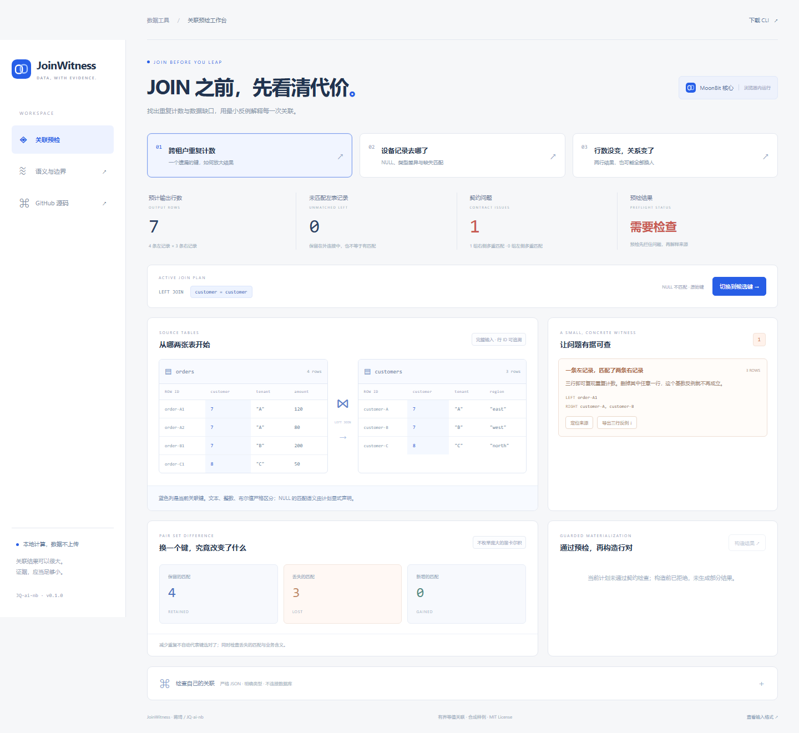

# JoinWitness

**执行关联前，看清哪些键会重复计数、丢失记录，以及反例在哪里。**

MoonBit 原创的有界等值关联预检库：精确输出规模、基数与覆盖率契约、可复现的三行反例、完整输入的缺失匹配核验，以及候选键的真实行对集合变化。

[在线工作台](https://jq-ai-nb.github.io/JoinWitness/) · [English](README.en.md) · [语义](docs/SEMANTICS.md) · [输入格式](docs/FORMAT.md) · [技术自检](docs/ACCEPTANCE.md)




## 为什么只比较行数不够

订单和客户表都按 `customer` 关联，但不同租户可以拥有相同的 customer ID。示例中 4 笔订单关联后会变成 7 行，其中一个订单可以匹配到两位客户。JoinWitness 导出 **1 笔订单 + 2 位客户** 的完整三行反例：去掉其中任意一行，这个特定的基数违规就不再成立。

候选复合键加入 `tenant` 后输出为 4 行，保留 4 个行对、去掉 3 个行对。是否确实符合业务含义仍由使用者判断。

另一个示例中，更换关联键前后都输出 2 行，但 **保留 0、丢失 2、新增 2**。总数完全一样，实际关联对象已经全部换掉。仅做 count 回归会漏掉这个变化。

## 已实现

- inner / left / right / full 等值关联；1..8 个可异名映射的组合键。
- 文本、整数、布尔值、NULL 严格区分；显式普通 SQL NULL 或组件式 null-safe 匹配。
- 通过键桶乘积计算精确匹配数量和外连接输出，提前判断预算，无需构造庞大的输出积。
- matched-group 基数契约、左右覆盖率、输出上限，互相独立检查。
- 违规来源行 ID、最小的三行多重匹配反例，以及针对完整对表核查的缺失匹配证据。
- 反例独立导出、再次检查，防止重复 ID、错误键与伪造范围被当作有效证据。
- 两套键的匹配行对交集与 lost/gained，既报告规模，也报告身份变化和新丢失覆盖。
- 全部契约通过后，按预算构造可追溯的完整来源行对；不输出失败事务的部分结果。
- 严格 JSON 协议、Node CLI、可运行 MoonBit 示例和交互式浏览器工作台。

## 运行

要求 MoonBit 编译器 **0.10.16 或更新兼容版本**、Node 22+。没有第三方 npm 依赖。

```sh
git clone https://github.com/JQ-ai-nb/JoinWitness.git
cd JoinWitness
moon check --target all --deny-warn
moon test --target all --deny-warn
moon build --target all --deny-warn
moon fmt --check
moon info
moon run cmd/demo
node scripts/build.mjs
node --test tests/cli.test.mjs
node scripts/serve.mjs
```

浏览器打开 `http://127.0.0.1:4175`。Native 编译还需要平台 C 工具链；Windows CI 使用 MSVC。

```sh
node bin/joinwitness.mjs check examples/tenant-collision.json
node bin/joinwitness.mjs case examples/tenant-collision.json 0
node bin/joinwitness.mjs materialize examples/tenant-collision.json --candidate
node scripts/benchmark.mjs
```

退出码 0：预检通过或成功导出；1：预检发现契约问题；2：无效输入、被拒绝的构造请求或 IO 错误。示例第一条 check **预期退出 1**，这是检测到问题。候选键只在显式 `--candidate` 时用于构造结果。

可选独立 SQL 对照：`python tests/sqlite_oracle.py`（SQLite 3.39+）。可选浏览器检查：安装 Python Playwright/Chromium，保持预览服务运行，执行 `python tests/browser.py`。

## 在 MoonBit 中调用

模块命名空间为 `JQ-ai-nb/joinwitness`。Mooncakes 发布状态见 [RELEASE.md](docs/RELEASE.md)；确认发布前请使用源码。

库接口提供 `plan`、`inventory`、`audit`、`compare`、`verify_witness`、`counterexample`、`materialize`；JSON 文本入口包括 `inspect_json`、`materialize_json`、`export_case_json`。公开签名见 [pkg.generated.mbti](pkg.generated.mbti)，[可执行 API 文档](API.mbt.md) 随测试验证。

## 质量、规模与边界

35 项 MoonBit 测试覆盖独立双重循环 oracle、组合键、NULL、基数、反例删除最小性、伪造证据、覆盖率、候选行对交集与资源限制。12 项 Node 集成测试验证真实 CLI/ESM；真实 SQLite 对照 320 组完整行对集合；Chromium 检查候选切换、反例下载、来源定位、注入文本和手机布局。CI 在 Linux/macOS/Windows 检查 wasm、wasm-gc、js、native。

Windows / i7-14650HX / Node 24 合成基准：两表各 10000 行的单键关联，精确预检 **1 亿**匹配对但不构造它们，中位约 **30.76ms**；两表各 5000 行的复合键比较中位约 **42.56ms**。包含解析、证据、比较和完整 JSON 输出，见 [基准范围](docs/BENCHMARK.md)。不将合成样例外推为生产吞吐承诺。

这是有界内存工具，不解析任意 SQL、不连接数据库，也不验证真实业务键的语义。最多每表 10000 行、64 列、8 个关联键，文本单元长度 512、每表文本总量 2 Mi UTF-16 单元，JSON 输入 8 Mi 单元；最多构造 20000 个来源行对。证据返回上限 128 条，但问题总数完整统计。字符串精确、区分大小写；没有数据库排序规则、类型强转、范围关联或浮点近似匹配。

三行反例仅用于构造式多重匹配违规；“没有匹配对象”必须结合完整对表核验，不能由一个空白小片段证明。证据复核不是加密来源认证，宿主负责可信输入、IO、持久化与隐私。

## 维护者与申报

蒋琦 / `JQ-ai-nb`。仓库作者和提交者统一为蒋琦，使用账户专属 GitHub noreply 邮箱；`python scripts/check_identity.py` 检查整个保留历史，CI 同样检查。

项目与 orbitcron、robopolicy、AgentCanary、TideWeave 的业务实现独立。JOIN、基数与反例是已有概念；独立贡献是具备明确边界的预检、证据复核与行对差分工具，而非发明关系运算。原创代码 MIT；AI 辅助开发已披露，维护者须理解和验证成果。标准库分发说明见 [THIRD_PARTY_NOTICES.md](THIRD_PARTY_NOTICES.md)。

十月正式申报书要求一页以内 Markdown，并注明“不要使用 AI 编写”。项目事实文档只能参考，正式申报书须由蒋琦本人理解后独立撰写；技术交付不等于完成报名或官方验收。见 [申报说明](docs/SUBMISSION.md)。
