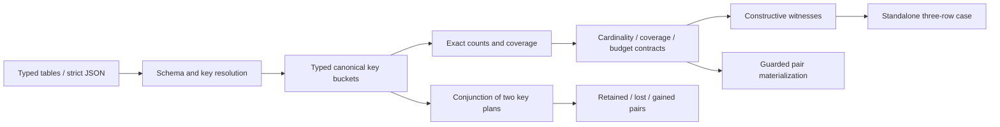

# Architecture and originality

`types.mbt` defines exact cells, validated schemas and plans. `inventory.mbt` groups eligible typed tuples and counts products without expanding them. Null-ineligible rows are tracked separately. `audit.mbt` evaluates independent contracts, bounds returned evidence, verifies facts against full input and exports constructive cases. `compare.mbt` uses the conjunction of predicates to count pair-set intersection without enumerating original or candidate products. `materialize.mbt` requires all preflight contracts to pass before allocating the result. `wire.mbt` supplies strict, versioned text boundaries.

Key encoding is a canonical JSON array of exact typed primitives, with no string delimiter collisions or implicit type coercion. Public key count is bounded at 8; the internal comparison predicate may use 16 positions when conjoining two valid plans. IDs are always interpreted in the context of their source side.

Main costs are input validation, key projection, bucket sorting and provenance output. Group pair counts are computed as Int64 products; materialization costs additional output cardinality only after admission. Full member lists make large outputs visible to hosts; this release deliberately caps input scale rather than promising unbounded processing.

JOIN, bag multiplicity, null-safe comparison and relational witnesses are established ideas. The independent contribution is a usable bounded core combining verifiable three-row examples, full-input absence scope, exact pair-set change analysis and guarded output in MoonBit, with CLI and browser consumers sharing the same core. It does not reuse the previous scheduling, crawler-policy, tool-policy or event-window domain implementations.
